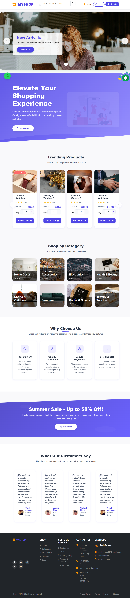

# Multi-Vendor E-Commerce Marketplace (Django)

A full-stack marketplace where **buyers** shop, **sellers** run their own storefronts, and an **admin** approves sellers and monitors the platform.



## Features

**Buyers**
- Browse categories and trending products, live search with autocomplete
- Cart and wishlist (AJAX, no page reloads), stock-aware quantity updates
- Checkout with Cash on Delivery or Razorpay (payments verified server-side)
- Order history, order tracking numbers, downloadable PDF invoices (WeasyPrint)

**Sellers**
- Register as a seller → wait for admin approval
- Seller dashboard: add / edit / delete own products with images
- See orders containing their products and update delivery status

**Admin panel** (custom, separate from Django admin)
- Platform stats: sellers, buyers, products, orders
- Approve pending sellers, drill into each seller's products, orders and customers

## Tech stack
Python · Django 4.2 · MySQL · Bootstrap 5 · jQuery / AJAX · Owl Carousel · WeasyPrint · Razorpay · Jazzmin

## Data model
Custom user model with roles (`buyer`, `seller`, `admin`), plus Category, Product, Cart, Wishlist, Order, OrderItem and Profile. See `ERD Diagram.png` and `DB Diagram.png`.

## Screenshots
| | |
|---|---|
|  |  |
|  |  |

## Run it locally
```bash
python -m venv venv
venv\Scripts\activate          # Windows  (source venv/bin/activate on macOS/Linux)
pip install -r requirements.txt
copy .env.example .env         # then fill in your MySQL details
python manage.py migrate
python manage.py createsuperuser
python manage.py runserver
```
Open http://127.0.0.1:8000. The admin panel is at `/adminpanel/`. To log in there, set the user's `role` to `admin`.

## Author
Sadia Farooq · sadiaafarooqfyp@gmail.com
